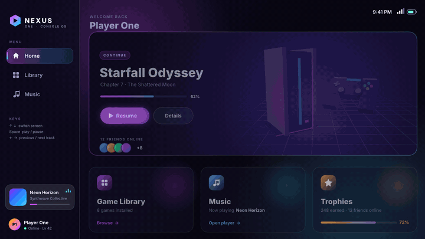
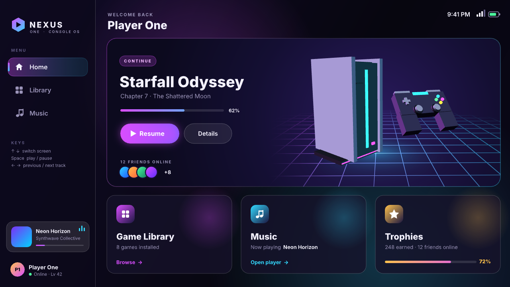
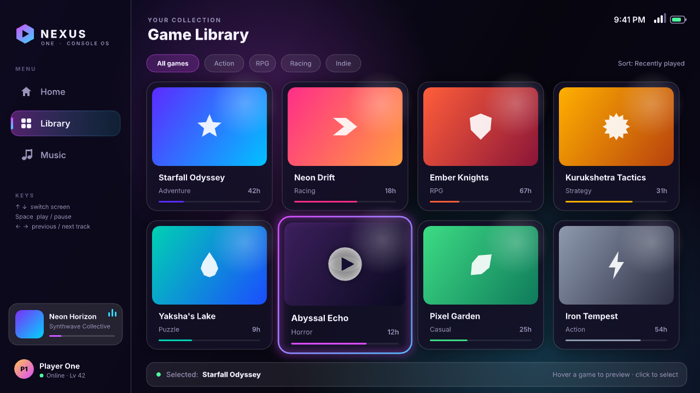
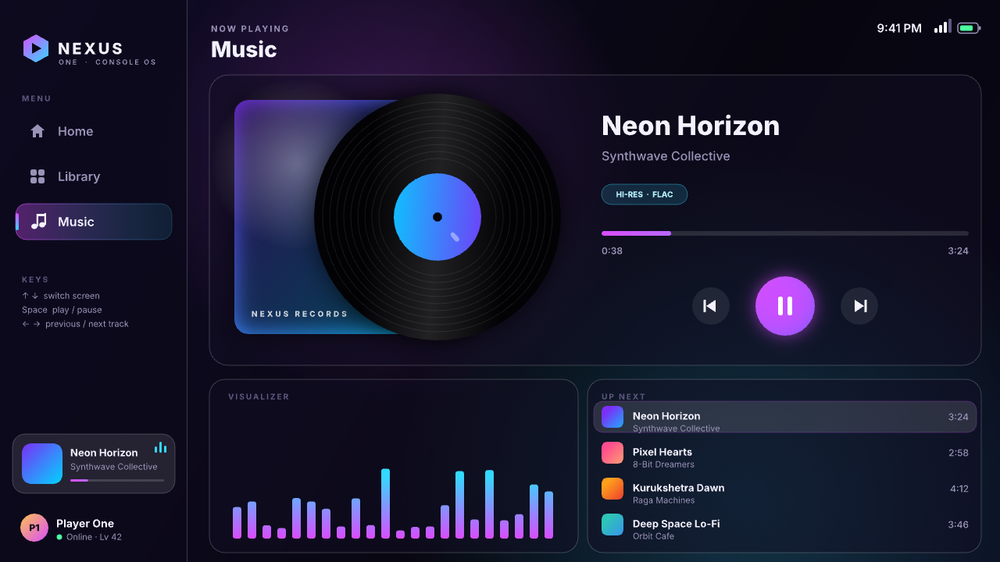

# NEXUS ONE: a 3D game console dashboard in Rive

An interactive console home screen built entirely with the [Rive CLI](https://rive.app/docs/cli/getting-started).
It has a real-time 3D hero scene, animated menus, a game library with hover cards and a
working music player.



| Home | Library | Music |
|---|---|---|
|  |  |  |

A full-resolution recording is in [`preview/demo.mp4`](preview/demo.mp4).

## What's inside

- **3D hero (Home):** A low-poly console and a floating gamepad, built procedurally and
  rendered on the GPU with WGSL. They're lit by a key light, two neon rim lights and glowing
  emissive parts, with a depth buffer, 4x MSAA and a scrolling neon grid floor. The console
  turns on a turntable and the gamepad bobs and spins.
- **Animated menus:** A sidebar menu with a sliding gradient pill, hover highlights and
  per-screen label colours. Screens cross-fade and slide in when you switch.
- **Game library:** Eight cards with gradient art. On hover, a card scales up, gets a neon
  halo and shows a play badge. Click a card to select it, and the selection bar updates.
- **Music player:** A spinning vinyl and an album sleeve that recolour per track, a live
  progress bar with elapsed and total time, play/pause/previous/next controls, a
  clickable "Up Next" queue and an animated visualizer. A mini player in the sidebar
  mirrors everything. Tracks advance on their own when one ends.
- **Top bar:** A ticking clock plus Wi-Fi and battery icons.

### Controls

| Input | Action |
|---|---|
| Click a menu item or Home tile | switch screen |
| `↑` / `↓` | previous / next screen |
| `Space` | play / pause |
| `←` / `→` | previous / next track |
| Hover / click a game card | preview / select it |
| Click a queue row | play that track |

## Running it

Install the CLI (macOS Apple Silicon, Linux x86_64, Windows):

```bash
curl -fsSL https://releases.rive.app/cli/install.sh | sh
```

```bash
export PATH="$HOME/.rive/bin:$PATH"
```

Then open the live preview window. It rebuilds every time you save a file:

```bash
rive console-dashboard
```

Other useful commands:

```bash
rive console-dashboard --verify                                 # compile + type-check scripts and shaders
```

```bash
rive inspect console-dashboard --summary                        # check bindings / state machine wiring
```

```bash
rive console-dashboard --screenshot=shot.png --advance=90       # headless capture
```

To ship it as a web page you need a Rive account, because scripted files must be signed:

```bash
rive login
```

```bash
rive console-dashboard --publish=web
```

## How it's built

| File | Role |
|---|---|
| `gen.py` | Generates `scene.rml`: the UI, view model, animations and the 18-layer state machine. **Edit this, then run `python3 gen.py`.** |
| `scene.rml` | The generated scene (artboard, shapes, text, listeners, states). |
| `console3d.luau` | `ScriptedLayout` that builds the console and gamepad meshes and renders them into a GPU canvas. |
| `console3d.wgsl` | Vertex and fragment shader: lighting, emissive pulse and the grid floor. |
| `player.luau` | Invisible `ScriptedLayout` that runs the music clock. It writes `progress`, `elapsed`, `total`, `disc` and `clock` into the view model and auto-advances tracks. |
| `Inter.ttf` | UI font (SIL Open Font License). |

The UI follows Rive's split between markup and scripts. Everything with a fixed structure
(panels, text, buttons, hover states) is RML, driven by one `Dash` view model. Only the 3D
scene and the player's clock are scripts. Listeners write view model properties, and state
machine layers read them:

- `Screens`: Home / Library / Music, switched by clicks (`screen`) or arrow keys (`moveUp`/`moveDown`).
- `Playback`: Playing / Paused (`togglePlay`), which swaps the play/pause icon and runs the visualizer.
- `Tracks`: one state per track (`next`, `prev` or `track`). Each state sets the title, artist and colours.
- `Ambient`: the drifting background glows.
- One small hover layer for each card, Home tile and menu item.

One design note: Rive composites a script's GPU canvas above surrounding markup. That's why
the 3D viewport sits to the right of the hero text instead of underneath it, and the
grid floor fades out at the viewport's left edge.
